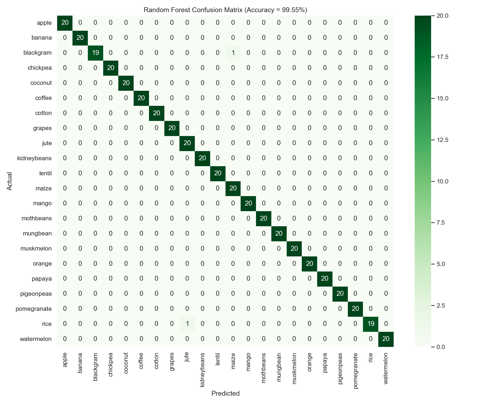
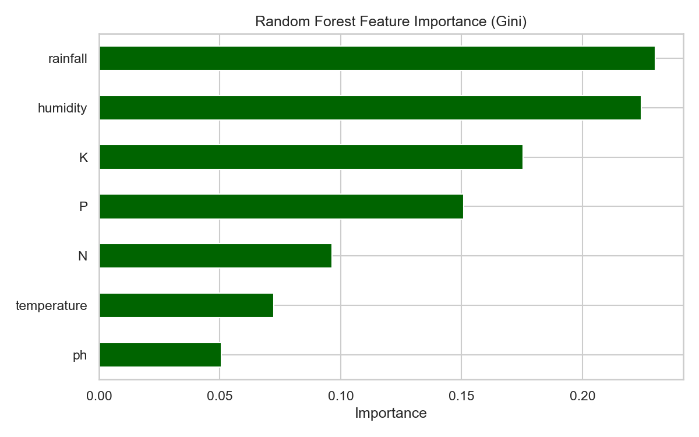
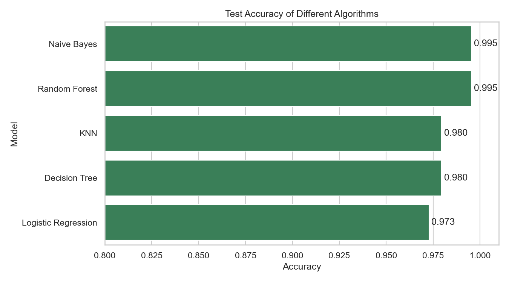
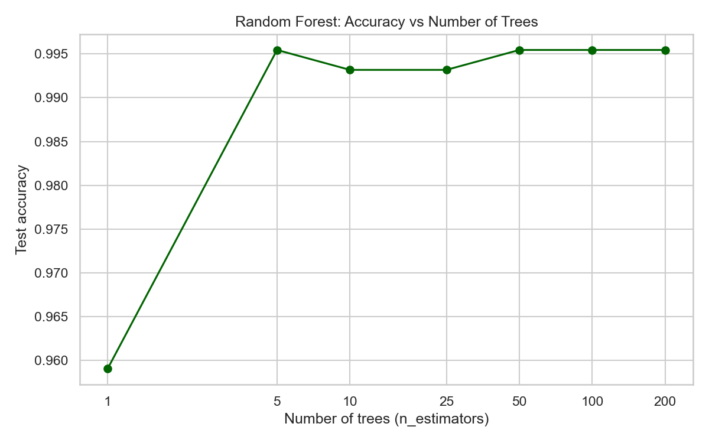

# 🌾 Crop Recommendation System for Precision Agriculture using Random Forest

**FAI Case Study** · Maddula Karthik (CH.SC.U4CSE23121) · Amrita Vishwa Vidyapeetham, Chennai

A machine learning system that recommends the most suitable crop to grow, based on soil nutrients and weather conditions, using a **Random Forest** classifier. It includes a training/evaluation script and an interactive web app built with Streamlit.

---

## 📌 Problem Statement

Choosing the wrong crop for a field's soil and climate leads to poor yield, wasted fertilizer and financial loss for farmers. Most farmers decide based on tradition or guesswork rather than data. This project uses machine learning to recommend the best crop from **7 measurable field conditions**, supporting **precision agriculture**.

## 📊 Dataset

**Source:** [Crop Recommendation Dataset – Kaggle](https://www.kaggle.com/datasets/atharvaingle/crop-recommendation-dataset)

- **2,200 samples**, **22 crops** (100 samples each – perfectly balanced)
- No missing values, no duplicates

| Feature | Description | Unit |
|---|---|---|
| N | Nitrogen content in soil | kg/ha |
| P | Phosphorus content in soil | kg/ha |
| K | Potassium content in soil | kg/ha |
| temperature | Average temperature | °C |
| humidity | Relative humidity | % |
| ph | Soil pH value | – |
| rainfall | Rainfall | mm |
| **label** | **Crop to grow (target)** | 22 classes |

**Crops:** rice, maize, chickpea, kidneybeans, pigeonpeas, mothbeans, mungbean, blackgram, lentil, pomegranate, banana, mango, grapes, watermelon, muskmelon, apple, orange, papaya, coconut, cotton, jute, coffee

## 🌲 Algorithm: Random Forest

Random Forest is an **ensemble** learning method that builds many **decision trees** and combines their votes:

1. **Bootstrap sampling (bagging):** each tree is trained on a random sample (with replacement) of the training data.
2. **Random feature selection:** at each split, a tree considers only a random subset of features, so the trees differ from each other.
3. **Splitting criterion:** each split is chosen to minimise **Gini impurity**.
4. **Majority voting:** for a new field, all 100 trees vote, and the crop with the most votes is recommended. The share of votes is used as the confidence score.

**Why Random Forest?** It handles non-linear relationships between features, doesn't need feature scaling, resists overfitting better than a single decision tree, and gives **feature importance** scores that explain which conditions matter most.

## ⚙️ How It Works

```
Input (7 values)                     Random Forest (100 trees)            Output
N, P, K, temperature,      ──►      each tree votes for a crop    ──►    Recommended crop
humidity, pH, rainfall              majority vote wins                    + confidence + top 3
```

**Pipeline:** load data → exploratory analysis → 80/20 stratified train-test split → train Random Forest → evaluate (accuracy, precision, recall, F1, 5-fold CV, confusion matrix) → feature importance → compare with other algorithms → save model → web app.

## 📈 Results

| Metric | Score |
|---|---|
| Test Accuracy | **99.55%** (438 / 440 correct) |
| Precision (macro) | 0.9957 |
| Recall (macro) | 0.9955 |
| F1-score (macro) | 0.9955 |
| 5-Fold Cross-Validation | 99.55% ± 0.32% |

**Comparison with other algorithms (test accuracy):**

| Model | Accuracy |
|---|---|
| Random Forest | 99.55% |
| Naive Bayes | 99.55% |
| K-Nearest Neighbors | 97.95% |
| Decision Tree | 97.95% |
| Logistic Regression | 97.27% |

**Feature importance:** rainfall (23%) > humidity (22%) > K (18%) > P (15%) > N (10%) > temperature (7%) > pH (5%)

**Number of trees:** a single tree reaches 95.9% accuracy; 5 or more trees reach about 99.5%, which shows the benefit of ensembling.

| Confusion Matrix | Feature Importance |
|---|---|
|  |  |

| Model Comparison | Accuracy vs Number of Trees |
|---|---|
|  |  |

## 📁 Project Structure

```
Fai_project/
├── data/
│   └── Crop_recommendation.csv   # dataset
├── outputs/                      # charts, reports and saved model (created by model.py)
├── model.py                      # training, evaluation and charts
├── app.py                        # Streamlit web app (demo)
├── requirements.txt              # Python libraries
└── README.md
```

## ▶️ How to Run

**1. Clone the repository and install the libraries**
```bash
git clone <this-repo-url>
cd <repo-folder>
pip install -r requirements.txt
```

**2. Train and evaluate the model** (takes a few seconds; saves charts and model to `outputs/`)
```bash
python model.py
```

**3. Launch the web app**
```bash
python -m streamlit run app.py
```
Then open http://localhost:8501 in your browser. Enter the field conditions using the sliders (or load an example) and click **Recommend Crop**.

## 🖥️ Web App Features

- **Recommend tab:** sliders for the 7 inputs, example presets, the recommended crop with a confidence score, a top-3 chart and a comparison with the crop's ideal conditions
- **Model Performance tab:** accuracy metrics and evaluation charts
- **Dataset tab:** the full dataset and average conditions per crop

## ⚠️ Limitations & Future Work

- The dataset is small (2,200 samples) and fairly clean, which partly explains the very high accuracy. Real field data would be noisier.
- It doesn't consider soil type, location, season, market prices or water availability.
- **Future work:** use real-time weather APIs and soil sensors (IoT), add regional and seasonal data, support local languages, and build a mobile app for farmers.

## 🛠️ Tech Stack

Python · pandas · NumPy · scikit-learn · Matplotlib · Seaborn · Streamlit · joblib

## 👤 Author

**Maddula Karthik**
Roll No: CH.SC.U4CSE23121
Amrita Vishwa Vidyapeetham, Chennai
